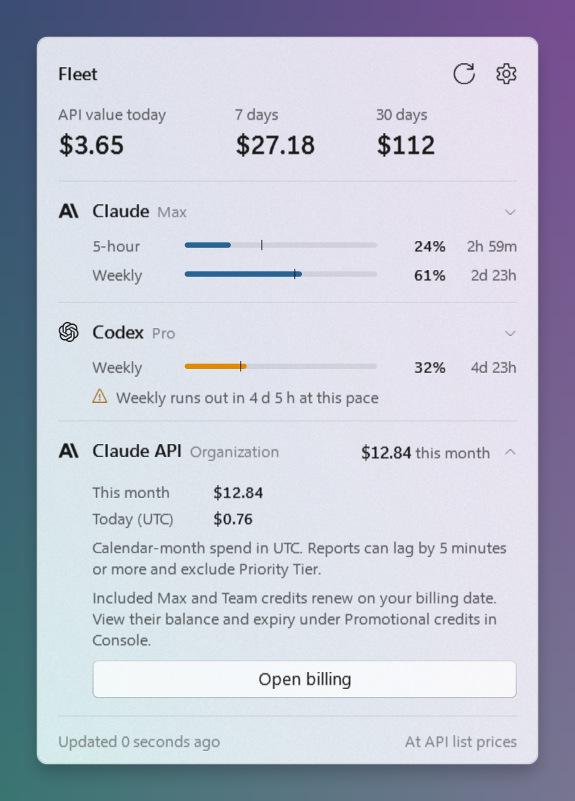

# Fleet



**One small Windows 11 tray app for every AI quota you pay for.**

Fleet watches local coding clients and public API accounts, then puts live usage,
reset times, balances, and cached freshness one click away.

[](https://github.com/okisooo/fleet/releases/latest)
[](https://github.com/okisooo/fleet/actions/workflows/ci.yml)
[](LICENSE)

> [!IMPORTANT]
> Fleet is Windows-only. Provider endpoints and local credential formats can
> change without notice. Fleet is independent and is not affiliated with any
> provider listed below.

## Download

Get the latest release from **[GitHub Releases](https://github.com/okisooo/fleet/releases/latest)**:

- **Installer** — `Fleet-Setup-<version>.exe`; per-user install, no admin prompt.
- **Portable ZIP** — unzip anywhere and run `Fleet.exe`.

The installer can start Fleet when you sign in. No Python, terminal, provider CLI,
or separate runtime is needed.

> [!WARNING]
> Releases are currently unsigned. Windows SmartScreen may show a reputation
> warning on first launch. Verify that your download came from the Fleet Releases
> page.

## What Fleet shows

- Claude Code, Codex, Grok, and Antigravity local client usage.
- Public API balances and limits from OpenRouter, DeepSeek, Kimi/Moonshot,
  MiniMax, Z.AI, LiteLLM, OpenAI Admin, and Anthropic Admin APIs.
- Optional rate-limit probes for OpenAI, Anthropic, Groq, Mistral, Together,
  Fireworks, Cerebras, DeepInfra, Nebius, xAI, and Perplexity.
- Custom entries for gateways, proxies, and self-hosted endpoints.
- Live, cached, and unavailable status for every provider.
- Usage windows, percentage bars, reset countdowns, credits, and balances.
- A compact notification-area flyout with no dashboard to keep open.


Green means live. Amber means Fleet is showing the last successful reading and
its age. Red means no usable reading exists.

## Quick start

1. Install a release from [GitHub Releases](https://github.com/okisooo/fleet/releases/latest).
2. Sign in to the local clients you want Fleet to inspect.
3. For API providers, set the matching environment variable and restart Fleet.

```powershell
setx OPENROUTER_API_KEY "your-key"
```

Left-click the tray icon to open or close the flyout. Right-click for **Refresh
now** or **Quit**.

See the complete provider list with:

```powershell
Fleet.exe --providers
```

## Public API keys

Fleet reads API keys from environment variables. It never puts key values in
`providers.json`.

Free, read-only usage endpoints activate automatically when their key exists.
Providers whose quota is exposed only through inference response headers are
disabled by default because checking them sends a one-token request. Enable those
with `"probe": true` in `providers.json` only when you accept that request and its
possible cost.

Full provider matrix and setup details: [docs/providers.md](docs/providers.md).

## Custom providers

Create `%LOCALAPPDATA%\Fleet\providers.json` beside the packaged app state, or
`providers.json` in the repository when running from source:

```json
{
  "custom": [
    {
      "id": "my-gateway",
      "label": "My Gateway",
      "url": "https://gateway.example.com/usage",
      "env": "MY_GATEWAY_API_KEY",
      "metrics": [
        {
          "label": "Monthly",
          "kind": "pct",
          "used": "usage.month",
          "limit": "limits.month",
          "resets": "limits.reset_at"
        }
      ]
    }
  ]
}
```

Custom requests use HTTPS, bearer authentication, a bounded response, and safe
JSON field paths. Loopback HTTP is allowed for a proxy running on your own
machine. See [providers.example.json](providers.example.json) and
[docs/providers.md](docs/providers.md) for all mapping types.

## Privacy and safety

- No Fleet telemetry or Fleet backend.
- Credentials are read locally and sent only to the matching provider endpoint.
- Custom provider key values come from environment variables, never config files.
- Runtime cache lives in `%LOCALAPPDATA%\Fleet\.cache` for packaged builds and
  `.cache` for source builds.
- Claude refresh is delegated to Claude Code. Fleet does not ship copied OAuth
  client secrets.
- Antigravity uses its local language server when available. If the app is closed,
  Fleet can refresh a stored Antigravity token using OAuth metadata discovered
  from the local installation; that metadata is never bundled, logged, or stored
  by Fleet.
- `--debug` prints status and exception types, never tokens or response bodies.

Use Fleet only with accounts and machines you control. Review provider terms
before using undocumented usage endpoints.

## From source

Requirements: Windows 11, Python 3.13+, and any local provider clients you want
to inspect.

```powershell
git clone https://github.com/okisooo/fleet.git
cd fleet
py -3.13 -m venv .venv
.\.venv\Scripts\python.exe -m pip install -r requirements.txt
.\fleet-tray.cmd
```

Useful checks:

```powershell
.\.venv\Scripts\python.exe tray.py --dry
.\.venv\Scripts\python.exe fleet.py --once
.\.venv\Scripts\python.exe -m unittest discover -s tests -v
```

## Project status

Fleet is an experimental public release. It currently targets Windows 11 and
ships as version [v0.1.0](https://github.com/okisooo/fleet/releases/tag/v0.1.0).
Provider APIs, authentication flows, and local client formats are outside Fleet's
control; broken readings should be reported with provider name, Fleet version,
and redacted debug output.

Security reports: [SECURITY.md](SECURITY.md).
