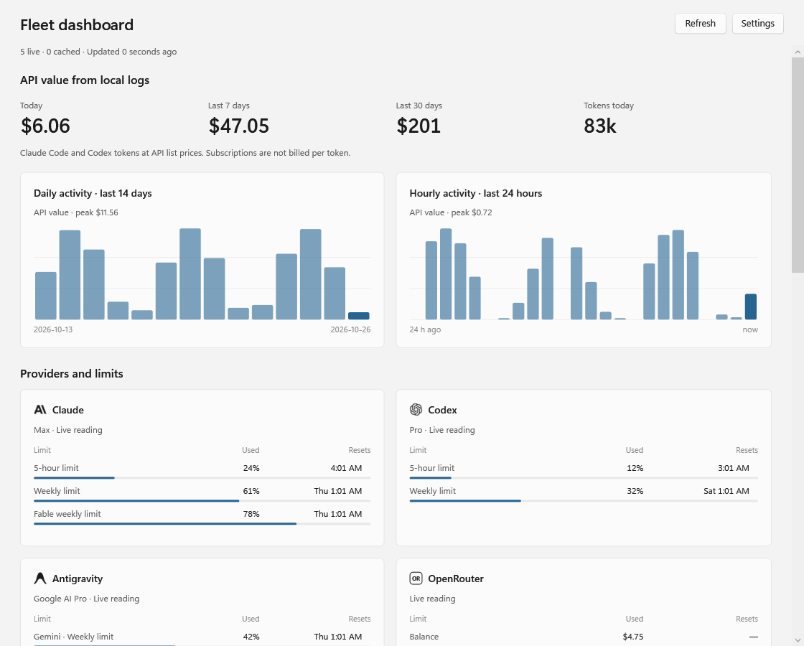

<p><a href="https://github.com/okisooo/fleet/releases/latest"><picture>
  <source media="(prefers-color-scheme: dark)" srcset="https://raw.githubusercontent.com/okisooo/fleet/main/docs/fleet-sleeve-dark.svg">
  
</picture></a></p>

<p align="center">
  <strong>ai usage and quota tracker for Windows 11</strong> · v0.4.0 · MIT<br>
  <a href="https://github.com/okisooo/fleet/releases/download/v0.4.0/Fleet-Setup-0.4.0.exe">Windows installer</a> · <a href="https://github.com/okisooo/fleet/releases/download/v0.4.0/Fleet-0.4.0-portable.zip">portable ZIP</a> · <a href="#quick-start">setup</a> · <a href="docs/providers.md">provider guide</a>
</p>

track Claude Code, OpenAI Codex, Grok CLI, Google Antigravity, and API providers
without opening each service. a tray meter tracks quota pressure; the native flyout
brings limits, reset times, pace, balances, and what your tokens would cost at API
prices together. choose **Dashboard** for a larger, resizable window that stays
open while you work. readings are marked **live, cached, or unavailable**, so an
older result stays visibly older.

<p align="center">
  <picture>
    <source media="(prefers-color-scheme: dark)" srcset="docs/screenshot-dark.png">
    
  </picture>
  <br><sub>v0.4.0 native flyout; sample data. readings depend on your connected accounts.</sub>
</p>

## dashboard

click **Dashboard** at the top of the flyout, or right-click the tray icon and
choose **Dashboard**. the native window shows all reported provider limits,
reset times, API balances/spend, and local Claude Code/Codex usage in one place.
resize it for one or two columns; **Refresh** and **Settings** stay at the top.

local history includes 24-hour and 14-day activity, token/cache breakdowns for
today, 7 and 30 days, and up to 20 models and projects from the last 7 days.
only Claude Code and Codex supply this local history. these are API-price
estimates, separate from subscription limits and actual API account spending.
coverage notes flag compressed Codex archives that have not been indexed.

<picture>
  <source media="(prefers-color-scheme: dark)" srcset="docs/dashboard-dark.png">
  
</picture>

*sample data rendered from the native dashboard; no personal account or project data.*

## download

| v0.4.0 · Python included | getting started |
| --- | --- |
| **[Windows installer](https://github.com/okisooo/fleet/releases/download/v0.4.0/Fleet-Setup-0.4.0.exe)** | per-user install; no administrator prompt; optional start at sign-in |
| **[portable ZIP](https://github.com/okisooo/fleet/releases/download/v0.4.0/Fleet-0.4.0-portable.zip)** | extract and run `Fleet.exe` |

[release notes and SHA-256 checksums](https://github.com/okisooo/fleet/releases/tag/v0.4.0)
· [latest release](https://github.com/okisooo/fleet/releases/latest)

> [!WARNING]
> binaries are unsigned; Windows SmartScreen may show a reputation warning.
> download from this repository's releases and check the published checksums.

to upgrade, rerun the installer or quit Fleet before replacing portable files.
keep `_internal` beside `Fleet.exe` when upgrading a portable copy.

## what you can track

| source | available readings |
| --- | --- |
| **local clients** | Claude Code, OpenAI Codex, Grok CLI, and Google Antigravity quotas, using existing client credentials |
| **cost estimates** | what Claude Code and Codex tokens would cost at public API prices, from local logs: today, 7 and 30 days, plus burn rate. estimates only; subscriptions are not billed per token |
| **API providers** | OpenRouter, DeepSeek, Kimi/Moonshot, MiniMax, Z.AI, and LiteLLM balances or usage; OpenAI organization cost with an admin key |
| **Claude API** | free connection check for a regular key; this month's and today's (UTC) organization spend for an admin key. the included Max/Team credit balance is shown only in Claude Console, which **Open billing** links to |
| **opt-in probes** | rate-limit headers from OpenAI, Anthropic, and other supported APIs; real inference requests that may cost money |
| **custom providers** | map an HTTPS JSON usage endpoint for a gateway, proxy, or self-hosted service |

balances stay in the flyout; repeated zero-use quota windows collapse. support
and metrics vary by provider. see the [provider matrix and limitations](docs/providers.md),
including unsupported Gemini API keys and console-only dashboards.

## quick start

1. install or extract Fleet, then launch `Fleet.exe`.
2. install and sign in to the local clients you use on the same Windows account.
   keep Claude Code on `PATH` for login renewal.
3. for API providers, set the matching key, then choose **Refresh now** from the
   tray menu. for example:

   ```powershell
   setx OPENROUTER_API_KEY "your-key"
   ```

left-click the icon to toggle the flyout; right-click for **Refresh now** or
**Quit**. check Windows' tray overflow if the icon is hidden.

for a Claude API account, open **Settings → Claude API**, choose **Connect**, and
paste a key. Fleet keeps it in Windows Credential Manager for your Windows user,
never in config or cache files; environment variables still take precedence.
a regular key only lists models (free); organization spend needs an admin key.

other API usage endpoints activate when their key is available. **rate-limit probes
are off by default:** `"probe": true` sends a one-token inference request on each
poll, may cost money, and appears in the provider's logs.

custom endpoints and overrides go in `%LOCALAPPDATA%\Fleet\providers.json`
(packaged) or `providers.json` beside `fleet.py` (source). keep keys in environment
variables, not the config file. see the [setup guide](docs/providers.md) and
[example configuration](providers.example.json).

## privacy and troubleshooting

Fleet has no telemetry or hosted Fleet service. it reads local credentials and contacts
providers directly; authentication flows may refresh those credentials. saved
Claude API keys use Windows Credential Manager and admin keys are used only for
read-only cost reports. runtime
state lives in `%LOCALAPPDATA%\Fleet\.cache` (packaged) or `.cache` (source).
an authenticated local loopback bridge lets T3 Code read supported usage; it does
not expose Claude API admin keys.

for missing or stale readings, check sign-in or key setup, then **Refresh now**.
OpenRouter management keys show account credits; regular keys use a key
budget/spend fallback. see the [provider guide](docs/providers.md#built-in).

[report a bug](https://github.com/okisooo/fleet/issues/new?template=bug_report.yml)
with Fleet version, install type, Windows build, provider, and expected versus
actual behaviour. redact diagnostics; never post tokens, credential files,
`.cache` contents, or provider response bodies. report security issues privately
through [SECURITY.md](SECURITY.md).

this is an early public Windows 11 release. provider APIs and credential formats
can change without notice. Fleet is independent of the listed providers; their
names and artwork remain theirs. see [THIRD_PARTY_NOTICES.md](THIRD_PARTY_NOTICES.md).

## run from source

requires Windows 11, Git, and 64-bit Python 3.13 (used by CI). the flyout uses
Windows' .NET Framework/WPF. configure providers as above.

```powershell
git clone https://github.com/okisooo/fleet.git
cd fleet
py -3.13 -m venv .venv
.\.venv\Scripts\python.exe -m pip install -r requirements.txt
.\fleet-tray.cmd
```

diagnostics without opening the flyout:

```powershell
.\.venv\Scripts\python.exe fleet.py --providers
.\.venv\Scripts\python.exe tray.py --dry
```

`--providers` lists API-key configuration; `--dry` polls and prints readings.
for the native dashboard and key setup, install a .NET SDK and run
`dotnet build native\FleetPanel\FleetPanel.csproj -c Release` before launching
from source. without that build the Python launcher uses the compatibility
flyout. the release script builds the packaged copy; see
[building from source](CONTRIBUTING.md#building-a-release-locally).
see [CONTRIBUTING.md](CONTRIBUTING.md) and [CHANGELOG.md](CHANGELOG.md).

## more from OKISO

Fleet is no.02 in OKISO's little tools. no.01, [**Backdrop**](https://github.com/okisooo/backdrop),
adds custom images and animated GIF wallpapers to Claude Desktop, Codex Desktop, and
T3 Code, with blur and readability controls. no.03, [**practice room**](https://github.com/okisooo/NihongoRevisionSuite),
offers short Japanese practice rounds. [more projects by OKISO](https://github.com/okisooo).
